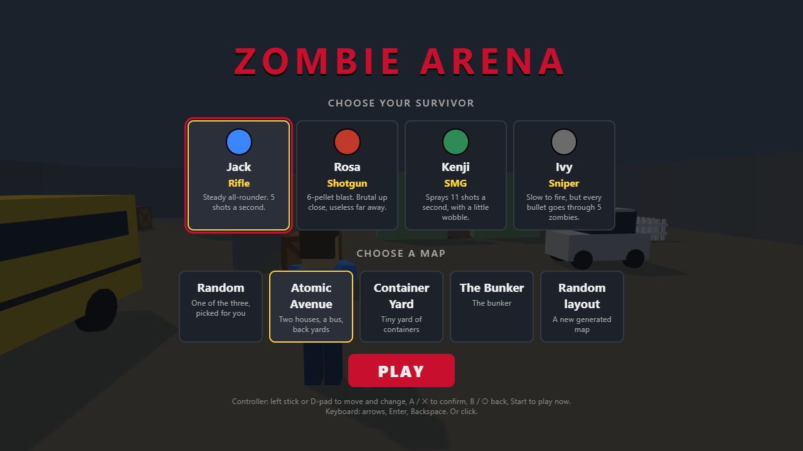
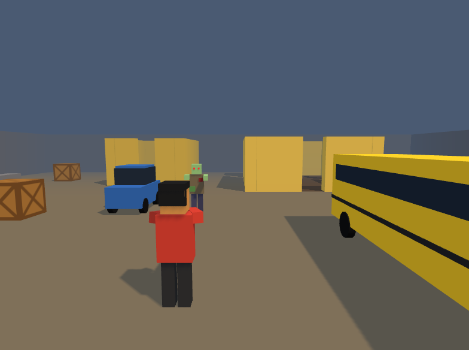

# Zombie Arena

A blocky 3D zombie survival shooter that runs in your browser, on PC, phone or tablet. Survive round after round as the zombies get more numerous and faster. Pick a survivor and their gun, and choose your map.

**▶ Play it here:** _add your Netlify link here_





## Features

- **Third-person 3D**, with the camera over your shoulder. Press **V** to switch to a top-down view.
- **Rounds:** each round has one more zombie than the last (up to 30). Zombies start slower than you and get faster until they outrun you.
- **4 survivors, each with their own gun:**
  - **Jack:** rifle.
  - **Rosa:** shotgun.
  - **Kenji:** SMG.
  - **Ivy:** sniper, whose bullets go through 5 zombies.
- **Maps:**
  - **Atomic Avenue:** houses, a school bus and back yards.
  - **Container Yard:** a tight yard of shipping containers.
  - **The Bunker:** rooms and broken doorways.
  - Or a **randomly generated layout**.
- **Zombie pathfinding:** zombies find their way around cover and in through doorways.
- **Jump** over crates and low walls. Zombies can't.
- **Plays three ways:** keyboard and mouse, a controller (Xbox or PlayStation), or touch on phones and tablets.
- **Settings:** mouse, controller and touch sensitivity, saved between visits.

## Controls

| Action | Keyboard and mouse | Controller | Touch |
|---|---|---|---|
| Move | W A S D | Left stick | Joystick under your left thumb |
| Look and aim | Mouse (click the game first) | Right stick | Drag on the right half of the screen |
| Shoot | Left click | RT / R2 | Hold **FIRE** (drag it to aim too) |
| Jump | Space | B (Xbox) / ✕ (PlayStation) | **JUMP** |
| Pause and settings | P or Esc | Start / Options | **❚❚** |
| Switch view | V | View / Share | – |

## Run it on your own computer

You need [Node.js](https://nodejs.org) (version 20 or newer).

```bash
npm install      # once, to download the tools
npm run dev      # start the game at http://localhost:5173 (it reloads when you save code)
npm test         # run the automated tests
npm run build    # make the dist/ folder to upload to a website host
```

## How it was made

I built this game as a Transition Year project to learn about developing software with AI. I used **spec-driven development**:

1. **Grill the idea.** Before writing any code, each feature was worked out by answering questions: what should happen, what are the numbers, what are the edge cases.
2. **Write a spec.** The answers became a written plan with user stories and decisions. All the specs are in [`.scratch/`](.scratch), starting with [the first one](.scratch/arena-shooter/spec.md).
3. **Test first.** Each rule got an automated test before the code that makes it pass. There are about 150 tests, in [`test/`](test).
4. **Play-test with a bot.** A simple AI bot played the game across every map and gun. It found a bug where zombies got stuck in narrow gaps, plus slowdowns and badly balanced weapons, and these were fixed.

### Where things are

| File | What it does |
|---|---|
| `src/game.js` | The rules: movement, shooting, zombies, rounds. It has no drawing code, so it can be tested. |
| `src/map.js` | Random map generation and the tile grid used for zombie pathfinding |
| `src/maps.js` | The hand-made maps |
| `src/view3d.js` | The 3D drawing ([Three.js](https://threejs.org)) |
| `src/main.js` | Connects everything: controls, menus, game loop and top-down drawing |
| `src/gamepad.js`, `src/touch.js`, `src/touchControls.js` | Controller and touch controls |
| `src/menus.js` | The start screen and pause menu |

Built with [Three.js](https://threejs.org), [Vite](https://vite.dev) and [Vitest](https://vitest.dev).

The map layouts are original, inspired by classic arena shooter maps.
